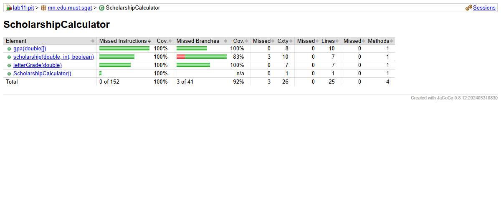
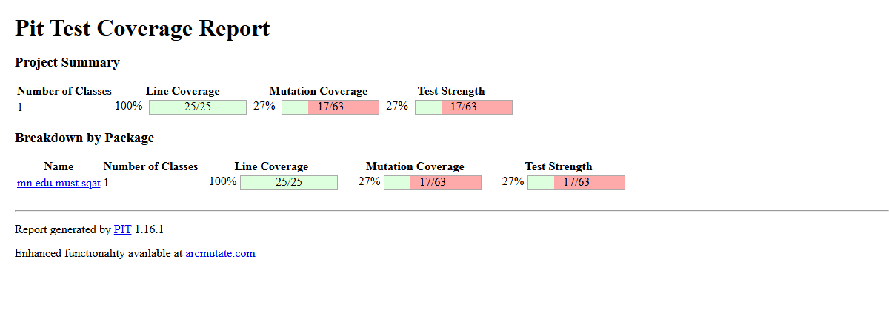
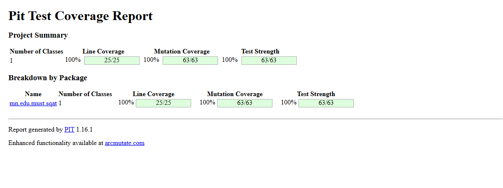
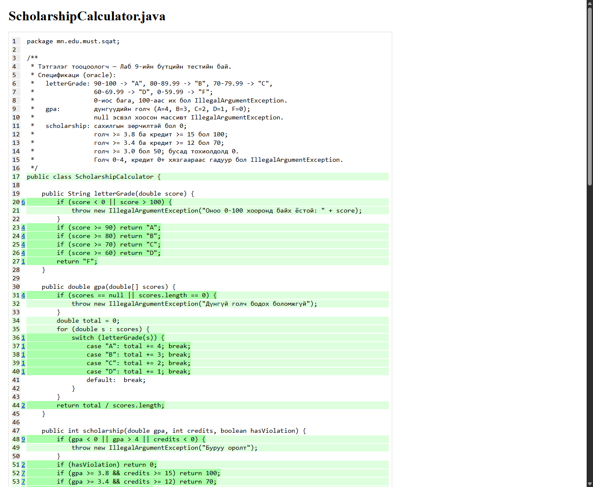

# Лаб 11: Mutation testing — PIT-ээр тестийн чанараа хэмжих

**Овог нэр:** С. Одгэрэл<br>
**Оюутны код:** B232270099<br>
**Хичээл:** F.CSA313 Программ хангамжийн чанарын баталгаа ба тест

```text
$ java -version
openjdk version "17.0.21.0.2" 2026-10-22 LTS
OpenJDK Runtime Environment Microsoft-15779939 (build 17.0.21.0.2+1-LTS)
OpenJDK 64-Bit Server VM Microsoft-15779939 (build 17.0.21.0.2+1-LTS, mixed mode, sharing)

$ mvn -version
Apache Maven 3.9.16 (2bdd9fddda4b155ebf8000e807eb73fd829a51d5)
Maven home: C:\Users\Surface\Downloads\apache-maven-3.9.16-bin\apache-maven-3.9.16
Java version: 17.0.21.0.2, vendor: Microsoft, runtime: C:\Program Files\Microsoft\jdk-17.0.21.21-hotspot
Default locale: en_US, platform encoding: Cp1252
OS name: "windows 11", version: "10.0", arch: "amd64", family: "windows"
```

> Орчин: Windows 11 (Git Bash). Тэмдэглэл: төслийн замд `(`, `)` тэмдэгт байхад (жишээ нь `starter(3)/lab11-pit`)
> PIT `No mutations found` алдаа өгсөн тул төслийг хаалтгүй зам руу зөөж ажиллуулсан.

Ажиллуулах:

```bash
mvn clean verify                                          # JUnit + JaCoCo
mvn test-compile org.pitest:pitest-maven:mutationCoverage # PIT
```

## 1. Эхний хэмжилт (starter)

JaCoCo (`results/jacoco-start.csv`, `results/mvn-verify-start.txt`): **Line 100% (25/25), Branch 38/41 (92%)**



PIT (`results/pit-start.txt`):

```text
>> Line Coverage (for mutated classes only): 25/25 (100%)
>> Generated 63 mutations Killed 17 (27%)
```



**Ажиглалт:** JaCoCo мөр бүрийг 100% ажилласан гэж харуулж байгаа ч PIT-ийн 63 мутантын зөвхөн 17 нь (27%) л
алагдсан. Энэ нь тестүүд кодыг *ажиллуулдаг* боловч үр дүнг нь бараг *шалгадаггүй* гэсэн үг — `assertNotNull`,
`assertTrue(0..100)` мэт сул assertion-ууд буруу утга буцаасан ч унахгүй. Line coverage нь "аль код ажилласан"-ыг,
mutation score нь "тест алдааг барьж чадах эсэх"-ийг хэмждэг тул хоёр өөр зүйл.

## 2. Хэсэг A — Амьд мутантуудын ангилал

Starter дээр 63 − 17 = **46 мутант SURVIVED**. Мөрийн дугаар нь `ScholarshipCalculator.java`-ийнх.

| Мөр | Мутаци (PIT-ийн тайлбар) | Тоо | Ангилал | Арга хэмжээ |
|---|---|---|---|---|
| 20 | changed conditional boundary (`score < 0` → `<= 0`, `score > 100` → `>= 100`) | 2 | Тест дутуу | Зааг тест: `letterGrade(0)="F"`, `letterGrade(100)="A"` (B2) |
| 23 | changed conditional boundary (`>= 90` → `> 90`) | 1 | Тест дутуу | Зааг тест: `letterGrade(90)="A"`, `letterGrade(89.99)="B"` (B2) |
| 23 | removed conditional – replaced comparison check with true / false | 2 | Тест дутуу | `assertEquals("A"/"B", …)` яг утгаар шалгах (B1) |
| 23 | replaced return value with "" | 1 | Тест дутуу | `assertNotNull`-ийг `assertEquals("A", …)` болгох (B1) |
| 24 | changed conditional boundary (`>= 80` → `> 80`) | 1 | Тест дутуу | Зааг тест: 80 → "B", 79.99 → "C" (B2) |
| 24 | removed conditional – true / false; replaced return value with "" | 3 | Тест дутуу | Яг утгын assertion (B1) |
| 25 | changed conditional boundary (`>= 70` → `> 70`) | 1 | Тест дутуу | Зааг тест: 70 → "C", 69.99 → "D" (B2) |
| 25 | removed conditional – true / false; replaced return value with "" | 3 | Тест дутуу | Яг утгын assertion (B1) |
| 26 | changed conditional boundary (`>= 60` → `> 60`) | 1 | Тест дутуу | Зааг тест: 60 → "D", 59.99 → "F" (B2) |
| 26 | removed conditional – true / false; replaced return value with "" | 3 | Тест дутуу | Яг утгын assertion (B1) |
| 27 | replaced return value with "" (`return "F"`) | 1 | Тест дутуу | `assertEquals("F", letterGrade(30))` (B1) |
| 36 | Changed switch default to be first case | 1 | Тест дутуу | F дүнтэй голч `gpa({40}) == 0.0` яг шалгах (B1) |
| 38 | Replaced double addition with subtraction (`total += 3`) | 1 | Тест дутуу | `gpa({95,85}) == 3.5` (B1) |
| 40 | Replaced double addition with subtraction (`total += 1`) | 1 | Тест дутуу | `gpa({75,65}) == 1.5` (B1) |
| 44 | replaced double return with 0.0d | 1 | Тест дутуу | Голчийг яг утгаар шалгах (B1) |
| 48 | changed conditional boundary (`gpa < 0` → `<= 0`, `credits < 0` → `<= 0`) | 2 | Тест дутуу | Оролтын хязгаар: `scholarship(0.0, 0, false) = 0` хүчинтэй (B2) |
| 48 | removed conditional – replaced comparison check with true | 1 | Тест дутуу | Хязгаар доторх оролтын яг утга + хязгаарын тест (B1/B2) |
| 51 | removed conditional – replaced equality check with true / false (`hasViolation`) | 2 | Тест дутуу | `assertEquals(0, scholarship(4.0,20,true))` ба `assertEquals(100, scholarship(3.9,16,false))` (B1) |
| 52 | changed conditional boundary (`>= 3.8`, `>= 15`) | 2 | Тест дутуу | Зааг: (3.8,15) → 100, (3.79,15) → 70, (3.8,14) → 70 (B2) |
| 52 | removed conditional – true / false (2 нөхцөл); replaced int return with 0 | 5 | Тест дутуу | `assertEquals(100, …)` (B1) |
| 53 | changed conditional boundary (`>= 3.4`, `>= 12`) | 2 | Тест дутуу | Зааг: (3.4,12) → 70, (3.39,12) → 50, (3.4,11) → 50 (B2) |
| 53 | removed conditional – true / false (2 нөхцөл); replaced int return with 0 | 5 | Тест дутуу | `assertEquals(70, …)` (B1) |
| 54 | changed conditional boundary (`>= 3.0` → `> 3.0`) | 1 | Тест дутуу | Зааг: 3.0 → 50, 2.99 → 0 (B2) |
| 54 | removed conditional – true / false; replaced int return with 0 | 3 | Тест дутуу | `assertEquals(50, …)` (B1) |
| | **Нийт** | **46** | | |

**Ангиллын үндэслэл:**

- **Тест дутуу (46/46):** мутант бүр ядаж нэг оролт дээр өөр үр дүн (өөр үсгэн дүн, өөр голч, өөр тэтгэлгийн хувь,
  эсвэл exception шидэх/шидэхгүй) өгдөг, өөрөөр хэлбэл бодит зан төлөвийг өөрчилдөг тул тест дутуу.
  - *Boundary* мутантууд зөвхөн яг заагийн утга дээр (90, 80, 3.8, 15, 0, 100 г.м.) ялгаатай болдог — тэдгээр утгыг
    тестэлдэггүй тул амьд үлдсэн.
  - *Return value / removed conditional / math* мутантууд буруу утга буцаадаг ч `assertNotNull` ба
    `assertTrue(муж)` тэр буруу утгыг хүлээн зөвшөөрдөг тул амьд үлдсэн.
- **Equivalent (0):** Амьд мутантуудын аль нь ч бүх оролт дээр анхны кодтой ижил ажилладаггүй тул equivalent гэж
  ангилсан мутант алга.

## 3. Хэсэг B — Тестүүдээ хүчтэй болгох

**B1 — Assertion-уудыг хүчтэй болгох.** Оролтуудыг өөрчлөлгүйгээр `assertNotNull` / `assertTrue(0 ≤ x ≤ 100)`
шалгалтуудыг яг утгын `assertEquals` болгосон: `letterGrade(95) = "A"`, `gpa({95,85}) = 3.5`,
`gpa({75,65}) = 1.5`, `gpa({40}) = 0.0`, `scholarship(3.9,16,false) = 100`, `scholarship(4.0,20,true) = 0` г.м.
Энэ алхмаар *return value*, *removed conditional*, *math*, *switch* мутантууд алагдсан.

**B2 — Зааг утгын тестүүд нэмэх.**
- `letterGrade`: 100, 90/89.99, 80/79.99, 70/69.99, 60/59.99, 0 ба хүрээнээс гадуур −0.01, 100.01.
- `gpa`: switch-ийн бүх үсгэн дүн (A=4, B=3, C=2, D=1, F=0) тус тусдаа + холимог `{95,85,75,65,30}` = 2.0.
- `scholarship`: (3.8,15)→100, (3.79,15)→70, (3.8,14)→70; (3.4,12)→70, (3.39,12)→50, (3.4,11)→50;
  (3.0,0)→50, (2.99,20)→0; оролтын хязгаар gpa 0 ба 4, credits 0 хүчинтэй, −0.01 / 4.01 / −1 нь exception.
- `&&` нөхцлийн нэг тал нь л үнэн байх хослолууд: (3.5,16)→70, (3.9,13)→70, (3.1,13)→50, (3.5,5)→50 —
  "replaced comparison check with true" мутантуудыг алахад шаардлагатай байсан.

### Хэмжилтийн явц

| Хэмжилт | Файл | Тестийн тоо | Mutation Coverage (Killed) | Test Strength | JaCoCo Branch |
|---|---|---|---|---|---|
| Эхлэл | `results/pit-start.txt` | 6 | **17/63 (27%)** | 27% | 38/41 |
| B1-ийн дараа | `results/pit-B1.txt` | 6 | **45/63 (71%)** | 71% | 38/41 |
| B2-ийн дараа (эцсийн) | `results/pit-B2.txt` | 16 | **63/63 (100%)** | 100% | 41/41 (`results/jacoco-final.csv`) |

Файлуудын мөрүүд:

```text
results/pit-start.txt: >> Generated 63 mutations Killed 17 (27%)
results/pit-B1.txt:    >> Generated 63 mutations Killed 45 (71%)
results/pit-B2.txt:    >> Generated 63 mutations Killed 63 (100%)
```

Line coverage гурван хэмжилтэд бүгд 25/25 (100%) хэвээр байсан ч mutation score 27% → 71% → 100% болж өссөн.
B1-ийн дараа үлдсэн 18 мутант бүгд *conditional boundary* (13) ба `&&`-ийн нэг талыг `true` болгосон (5) мутант
байсан нь Хэсэг A-ийн "зааг тест дутуу" гэсэн дүгнэлттэй таарсан. Эцэст амьд мутант 0 тул equivalent гэж
хасах мутант байхгүй, Test Strength = 100%.

Эцсийн PIT тайлан:





## 4. Хэсэг C — Гараар нэг мутант (PIT-гүйгээр)

`scholarship()`-ийн 52-р мөрийг гараар өөрчилсөн:

```diff
-        if (gpa >= 3.8 && credits >= 15) return 100;
+        if (gpa > 3.8 && credits >= 15) return 100;
```

`mvn test 2>&1 | tee results/mvn-test-manual-mutant.txt` — **1 тест унасан:**

```text
[ERROR] mn.edu.must.sqat.ScholarshipCalculatorTest.scholarship_fullBoundary_3_8_and_15 -- Time elapsed: 0.139 s <<< FAILURE!
org.opentest4j.AssertionFailedError: expected: <100> but was: <70>
	at mn.edu.must.sqat.ScholarshipCalculatorTest.scholarship_fullBoundary_3_8_and_15(ScholarshipCalculatorTest.java:117)
[ERROR] Tests run: 16, Failures: 1, Errors: 0, Skipped: 0
```

Унасан мөр: `assertEquals(100, calc.scholarship(3.8, 15, false));` — B2-ийн зааг тест мутантыг барьсан.
Дараа нь `git restore src/main`-ээр буцаасан (мутацитай код commit хийгдээгүй; `src/main` нь Starter commit-той ижил).

### Өөрийн equivalent мутант

`gpa()`-ийн switch дотор `case "D"`-ийн `break`-ийг устгасан:

```diff
-                case "D": total += 1; break;
+                case "D": total += 1;
```

`mvn test` (`results/mvn-test-equivalent-mutant.txt`) → `Tests run: 16, Failures: 0` — ямар ч тест унаагүй.
**Тайлбар:** `break` устсан тул "D" салаа дараагийн `default:` салаа руу "унаж" ороход тэнд зөвхөн `break` байдаг
тул `total` өөрчлөгдөхгүй, функцийн үр дүн бүх оролт дээр анхныхтай яг ижил. Гадаас ажиглагдах зан төлөв огт
өөрчлөгдөөгүй тул ямар ч тест (хэчнээн хүчтэй байсан ч) энэ мутантыг алж чадахгүй — энэ бол жинхэнэ equivalent мутант.

## 5. Дүгнэлт

Code coverage (JaCoCo) нь тестийн явцад кодын аль мөр, аль салаа *ажилласан*-ыг л хэмждэг бол mutation score нь
тест кодын *алдааг барьж чадах эсэх*-ийг хэмждэг. Энэ лабад starter багц Line 100% өгч байсан ч mutation score
ердөө 27% байсан нь кодыг ажиллуулах нь түүнийг шалгахтай адил биш гэдгийг харуулсан. Assertion-уудыг яг утгын
болгоход (B1) score 71% болж, зааг утгын тестүүд нэмэхэд (B2) 100% хүрсэн — хоёр алхамд line coverage огт
өөрчлөгдөөгүй. Иймээс coverage бол тестийн чанарын доод хязгаар (хамраагүй кодыг тестлээгүй нь тодорхой), харин
mutation score бол assertion-ийн хүчийг шууд хэмжих үзүүлэлт юм. AI-гаар тест бичүүлэхэд AI ихэвчлэн кодыг
"дайрдаг" ч `assertNotNull`, муж шалгах зэрэг сул assertion эсвэл заагийн утгыг алгассан тест үүсгэх магадлалтай
бөгөөд ийм тест coverage-ийг өндөр харагдуулж хуурамч итгэл төрүүлдэг. Mutation testing нь ийм тестийн бодит
алдаа барих чадварыг объектив хэмжиж, аль мутант амьд үлдсэнээр яг ямар тест дутууг зааж өгдөг тул AI-ийн
бичсэн тестийг заавал PIT-ээр шалгах хэрэгтэй.
